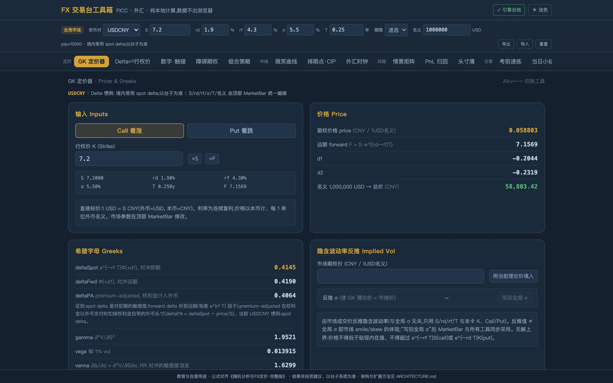
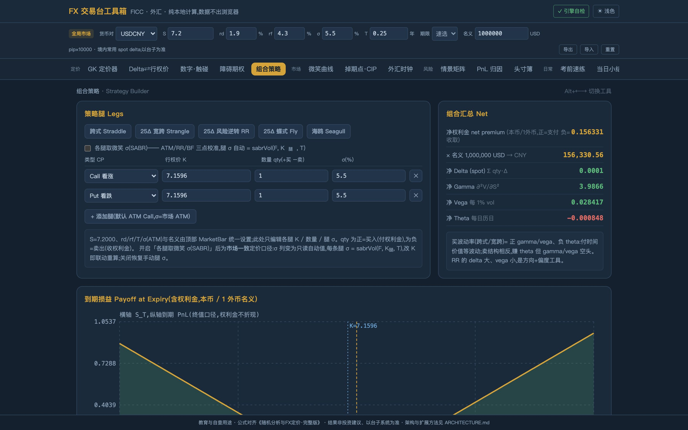
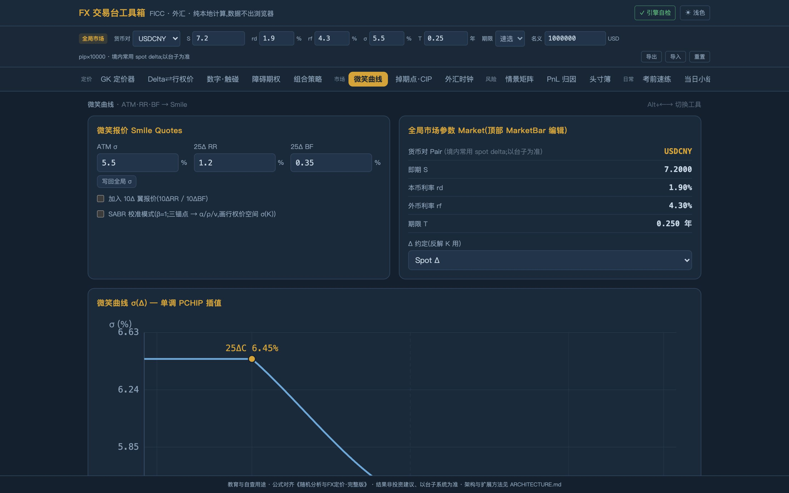
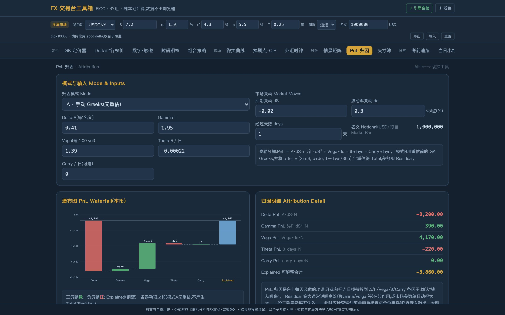
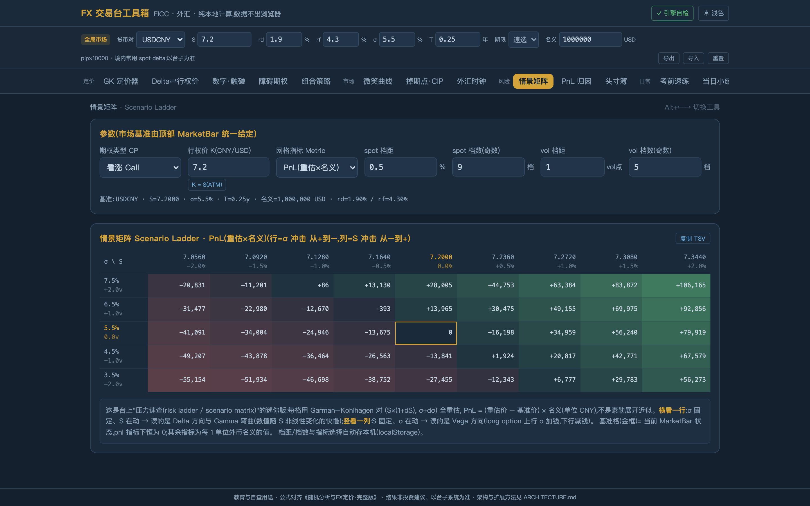
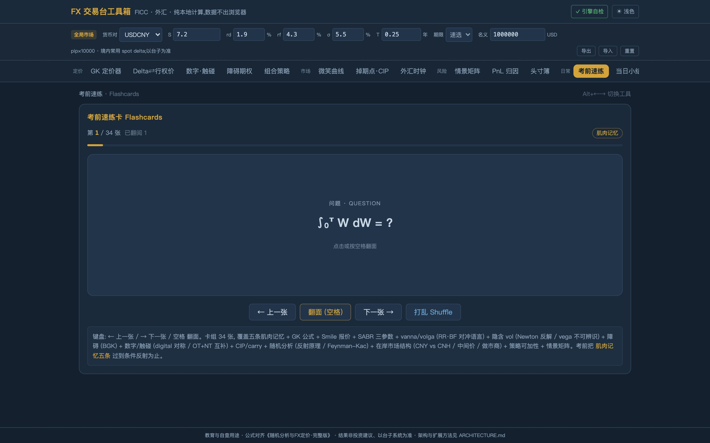
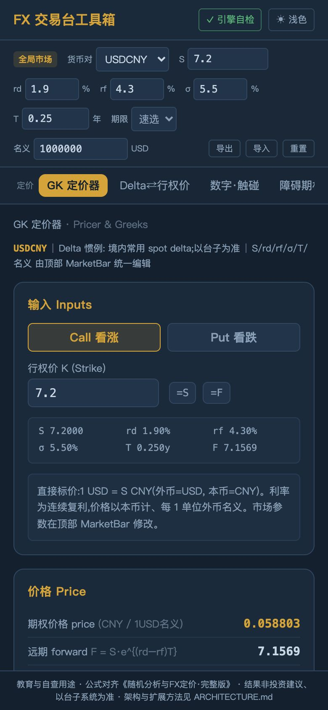

> [English](README.md) | 简体中文

<div align="center">

# FX 交易台工具箱 · fx-desk-toolkit

**外汇期权定价、市场与风险的随身工具箱：纯本地计算，一个 HTML 文件双击即用。**

13 个工具覆盖定价、市场、风险和日常四组；每个公式都有不变量测试兜底，<br>
右上角“引擎自检”在你的浏览器里实时验算，全绿才说明这份文件算得对。

[十三个工具](#十三个工具) &nbsp;·&nbsp; [正确性](#正确性不变量方法论) &nbsp;·&nbsp; [使用](#使用) &nbsp;·&nbsp; [隐私](#隐私与边界)


</div>

<p align="center"></p>

## 为什么做

交易台上经常要快速核一个数：这个 delta 用的是哪种约定、远期点该是多少、今天的 PnL 有多少来自 gamma。
现成的系统要么太重，要么不方便把参数随手拿出来算。这个工具箱把常用的计算做成**一个可以拷到任何机器、双击就能用的文件**：
不联网、不安装、不外发任何数据；同时用不变量测试保证公式没有算错。

## 看一眼

<table>
<tr>
<td width="50%"><br><sub><b>组合策略</b>：跨式、宽跨、风险逆转、蝶式、海鸥一键构建，净希腊字母加到期损益图</sub></td>
<td width="50%"><br><sub><b>微笑曲线</b>：ATM、RR、BF 重建波动率微笑，SABR 三点校准</sub></td>
</tr>
<tr>
<td width="50%"><br><sub><b>PnL 归因</b>：Delta、Gamma、Vega、Theta、Carry 瀑布，期权模式全重估给出残差</sub></td>
<td width="50%"><br><sub><b>情景矩阵</b>：即期 × 波动率冲击热力网格，逐格重估，一键复制进 Excel</sub></td>
</tr>
</table>

<p align="center">
&nbsp;
<br>
<sub>34 张翻面速练卡；手机上也能用</sub>
</p>

## 十三个工具

| 组 | 工具 | 干什么 |
|----|------|--------|
| 定价 | **GK 定价器** | GK 期权价 + 全套希腊字母(含 vanna/volga)+ **隐含σ反推** |
| 定价 | **Delta⇄行权价** | 四种 delta 约定互算 K;ATMF / DNS(pips) / DNS(pa) 一键 |
| 定价 | **数字·触碰** ★ | 现金/资产数字、one-touch/no-touch(含对称性自检行) |
| 定价 | **障碍期权** | 8 种敲入敲出闭式解 + BGK 修正 + in–out 平价自检 |
| 定价 | **组合策略** ★ | 多腿构建(5 预设),净希腊字母 + 损益图 + **各腿取微笑σ(SABR)** |
| 市场 | **微笑曲线** | ATM·RR·BF 重建 σ(Δ) + **SABR 三点校准**(α/ρ/ν + 行权价空间曲线) |
| 市场 | **掉期点·CIP** | 理论远期两口径;市场价反推隐含利率与交叉货币基差 |
| 市场 | **外汇时钟** | 北京时间 session 带 + 9:15 中间价等关键时点倒计时 |
| 风险 | **情景矩阵** ★ | spot×vol 冲击热力网格(逐格重估)+ **复制 TSV 进 Excel** |
| 风险 | **PnL 归因** | Δ/Γ/vega/θ/carry 瀑布;期权模式全重估出 residual |
| 风险 | **头寸簿** ★ | 本地记账 + 全局参数实时重估,净 delta/vega/theta 汇总 |
| 日常 | **考前速练** | 34 张翻面卡(速查卡/考前 28 题精华) |
| 日常 | **当日小结** | 每日小结生成器,自动带行情快照,一键复制 |

★ = v2 新增。**全局市场参数条**:S/rd/rf/σ/T/名义/货币对在顶部一处编辑,所有工具联动(localStorage 持久化,可导出/导入 JSON);货币对切换自动带出 pip 因子与 delta 惯例(约定注册表)。

## 正确性：不变量方法论

- 引擎（L0 到 L2 层纯 TypeScript，零依赖、不碰 DOM）配 vitest 用例，目前共 40 个：恒等式（平价关系、Δ_pa ≡ Δ_spot − V/S、敲入加敲出等于香草、数字期权 C + P = e^(−rd·T)、一触即付与不触碰互补、策略等于各腿之和）、
  极限（障碍远去趋于香草、BGK 修正收敛）、往返（delta 与行权价互算、CIP 反解）、交叉对拍（数值希腊字母、BS 经典值 10.4506）。
- 右上角 **“✓ 引擎自检”**：同源的 15 项不变量在你的浏览器里实时跑，全绿才说明这份文件算得对。
- 方法论详见 [ARCHITECTURE.md §2](ARCHITECTURE.md)。

## 使用

```bash
npm install
npm run dev      # 开发（Alt + ←/→ 切换工具；右上角切换深浅主题）
npm test         # 40 个用例（数值不变量为主）
npm run build    # → dist/index.html，单文件自包含
```

**在交易台上用**：把 `dist/index.html` 这一个文件拷走，任何浏览器双击即用，无网络、无安装、无数据外发。

<details>
<summary><b>扩展与迁移（30 分钟配方）</b></summary>

- **加工具**：lib 纯函数 → 配不变量 → （可选）挂自检 → 写 `tools/*.tsx` → `App.tsx` 注册一行 → README 登记。
- **加货币对或改惯例**：只改 `src/lib/conventions.ts` 一行。
- **换品牌色或主题**：只改 `src/index.css` 的 `@theme` 令牌。
- **搬去 Python、Node、Excel 或真后端**：引擎零依赖可以直接搬，验收标准是把测试断言翻译过去跑通。详见 [ARCHITECTURE.md §6](ARCHITECTURE.md)。

</details>

## 隐私与边界

- **数据不出浏览器**：没有任何网络请求；市场参数、头寸簿和小结草稿只存在本机浏览器的 localStorage，可导出、导入 JSON。
- **用途边界**：教育与自查用途，非投资建议，以交易台系统与市场惯例为准。已知取舍（常数波动率、到期支付口径、固定夏令时口径）见 [ARCHITECTURE.md §7](ARCHITECTURE.md)。

## 技术

Vite · React 19 · TypeScript · Tailwind 4 · 手写 SVG（零图表库）· vite-plugin-singlefile · vitest

## 许可

[MIT](LICENSE)
